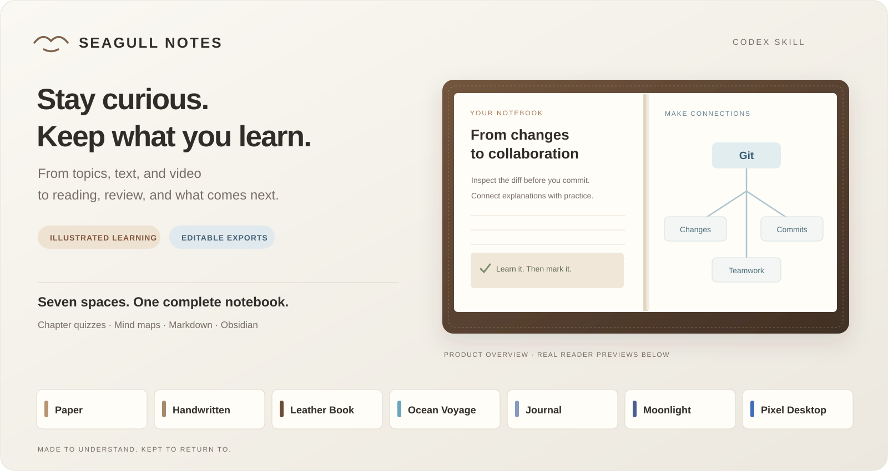
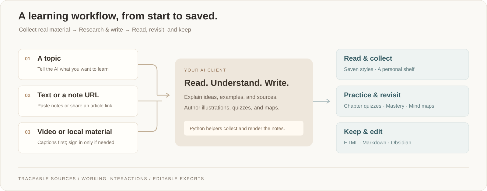
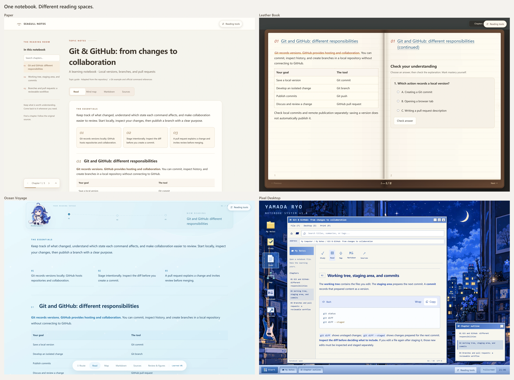

# Seagull Notes

English · [简体中文](README_CN.md)

**Turn what you watch, read, and want to learn into notes you can return to.**

A Codex skill for illustrated Chinese notebooks. Bring a topic, paste notes or an article link, or share a Bilibili / YouTube video. Get a personal shelf, seven reading styles, chapter quizzes, interactive mind maps, and editable exports.



[Get started](#get-started) · [Reading styles](#seven-reading-spaces) · [Learning tools](#built-for-reading-and-revisiting) · [Exports](#your-notes-stay-yours) · [Skill instructions](skill/SKILL.md)

## From material to a notebook

| Start with | What happens |
| --- | --- |
| **A topic** — “Help me learn Git and GitHub” | The AI researches reliable sources and builds an explained, illustrated lesson. |
| **Existing notes** — pasted text or an article / note URL | It reads the material, reorganizes the explanation, and preserves attribution. |
| **A video** — Bilibili, YouTube, or local material | It reads accessible captions with timestamps; source frames and explanatory diagrams are identified separately. |



Complete a platform sign-in or QR scan **only when access requires it**. Valid sessions and complete caption caches are reused. Platform captions, including automatic captions, come first; local speech recognition is an explicitly approved fallback.

The AI client reads and writes the lesson; Python helpers collect material and render the result. **No separate note-generation API key is needed** for this skill workflow. It uses your configured AI client.

## Seven reading spaces

Switch styles without losing the note’s full text, sources, code, formulas, or study progress.

| Style | Reading experience |
| --- | --- |
| **Paper** · `paper` | A quiet, continuous reader with chapter navigation and warm paper colors. |
| **Handwritten Notes** · `atlas` | Ruled pages, spiral binding, bundled handwriting, tape, and highlighted takeaways. |
| **Leather Book** · `folio` | Stitched leather, measured facing pages, animated page turns, and responsive single-page reading. |
| **Ocean Voyage** · `whale` | An open blue reading space, horizontal chapter route, and four whale-girl poses. |
| **Japanese Journal** · `journal` | A blue Ryo collage, torn paper, washi tape, five transparent stickers together, and editable quick memos. |
| **Moonlight Glass** · `moonlight` | A moonlit room with glass panels, a note shelf, sidebar, and chapter outline. |
| **Pixel Desktop** · `pixel` | Open **My Notes → a saved notebook → Study / Read / Map / Markdown / Sources** inside a working retro desktop. |



*Real renderer output, captured at 2× resolution. These documentation previews use English lesson text and translated interface labels. The installed skill and default interface currently use Chinese; this image does not indicate an English interface setting.*

Topic, text, and article notebooks default to Handwritten Notes. Video and local-material notebooks default to Paper. Choose another style in Reading Tools or with `--style`.

## Built for reading and revisiting

| Tool | What you can actually do |
| --- | --- |
| **Chapter learning loop** | Read, answer 2–3 authored multiple-choice questions per chapter, check explanations, and retry. Manually mark the chapter learned at its end; the journal checklist then checks and strikes through automatically. Quiz results do not change mastery for you. |
| **Interactive mind map** | Explore concepts, steps, and common mistakes in nested branches. Focus a branch, zoom around the pointer, pan, fit, or expand. Maps reflect the authored content, beyond chapter titles. |
| **Journal quick memos** | Add, edit, complete, and delete memos; undo the last deletion. Changes persist in this browser. |
| **Desktop windows** | Drag, minimize, restore, maximize, or enter fullscreen. Resize proportionally from any corner, or independently from any edge. The Start menu and taskbar work. |
| **Technical content** | Copy original code, wrap long lines, and click typeset formulas to copy LaTeX. Five font choices retain dedicated code and math typography. |
| **Personal shelf** | Browse saved notebooks, filter by source type, and search titles, summaries, and tags. Re-rendering the same input updates its entry. |
| **Smoother navigation** | Soft transitions between reading views, styles, shelves, and window states; reading positions are preserved. Reduced-motion preferences are respected. |

Long chapters continue across Leather Book pages instead of being cut off. Changing fonts or window size recalculates pagination while keeping your content position. The web reader embeds its assets for offline reading; external source links still need network access.

## Get started

Requires **Python 3.10+** and an AI client that can load the skill.

```bash
git clone https://github.com/J1ngYue/seagull-notes.git
cd seagull-notes
python -m pip install -e ".[notes,browser]"
```

Copy `skill/` to your client’s skills directory as `seagull-notes`, for example `~/.agents/skills/seagull-notes/`. Keep this Python project installed: copying the skill alone does not install its Python helpers. You can also use the skill directly from the checkout.

On Windows, use your actual Python installation rather than a Microsoft Store alias, for example `D:\software\Anaconda\python.exe`.

Then ask your AI client:

> Use seagull-notes to make detailed Chinese notes about Git and GitHub. Explain repositories, branches, pull requests, merging, and forks, with examples and chapter quizzes.

> Use seagull-notes to turn this video into illustrated Chinese notes: VIDEO_URL

> Organize the notes below into a Japanese Journal notebook. Preserve the source and distinguish your additions.

### Try the included notebook

No video fetch or generation API configuration is required for this rendering demo:

```bash
python skill/scripts/notebook.py examples/knowledge.json --style atlas --out data/artifacts/git-atlas
python skill/scripts/notebook.py examples/knowledge.json --style folio --out data/artifacts/git-folio
```

Open `data/artifacts/git-atlas.html` or `data/artifacts/git-folio.html`. The example contains **7 chapters, 14 chapter questions, and a 71-node mind map**, with official reference links. Generated notebooks also appear at `data/artifacts/notebooks/index.html`.

The renderer displays an authored JSON notebook; it does not write a lesson by itself. See the [input format](skill/references/notebook-format.md) and [material / style guide](skill/references/materials-and-styles.md).

## Your notes stay yours

| Output | Use it for |
| --- | --- |
| **Self-contained HTML** | Full browser reading, with embedded fonts, illustrations, formulas, and interactions. |
| **Markdown** | Copy all text or download a `.md` file. Plain Markdown keeps original image paths; keep those files alongside it. |
| **Obsidian package** | Native Markdown, independent attachments, source material, an editable Canvas mind map, and a scoped CSS snippet. The shelf offers individual and combined ZIPs. |
| **Print / PDF** | Print or save the complete notebook as PDF through browser printing. |

Optional direct import into an existing Obsidian vault:

```bash
python skill/scripts/notebook.py note.json --obsidian-vault "/absolute/path/to/vault"
```

Exports stay editable; re-import preserves existing vault files. Navigation uses Obsidian’s own interface, rather than reproducing the seven web interfaces inside Obsidian.

## More control when you need it

<details>
<summary><strong>Prepare topics, text, webpages, and captions</strong></summary>

```bash
python skill/scripts/prepare.py --kind topic --source "Git and GitHub"
python skill/scripts/prepare.py --kind text --file pasted-notes.txt
python skill/scripts/prepare.py --kind url --source "https://example.com/article"
python skill/scripts/fetch.py "VIDEO_URL"
python skill/scripts/fetch.py "/absolute/path/captions.srt"
python skill/scripts/notebook.py note.json --style journal
```

Preparation saves material for the AI to read; a topic request is a research brief, not a finished lesson. The skill checks coverage, retains verifiable references / timestamps, and labels its own explanatory additions. See [writing guidance](skill/references/materials-and-styles.md) and [figure guidance](skill/references/note-figures.md).

Full Bilibili BV links use a dedicated local collector by default. Complete caption caches and valid sessions are reused. When sign-in is necessary, it supplies a local `LOGIN_URL` for a QR scan, then resumes. `--anonymous` skips credentials; `--refresh` requests a fresh caption copy. The collector profile, in-app browser, and normal browser are separate sessions. Platform restrictions still apply. See [caption collection](skill/references/browser-subtitles.md).

</details>

<details>
<summary><strong>Optional local speech recognition</strong></summary>

ASR requires explicit approval, after ordinary and AI captions have been confirmed unavailable, or an explicit request to transcribe local media. A failed request or login does not establish that captions are absent.

```bash
python -m pip install -e ".[notes,asr]"
python -m seagull_notes.cli prepare-model
python skill/scripts/fetch.py "/absolute/path/lecture.wav" --allow-asr
# For accessible public video audio, after approval:
python skill/scripts/fetch.py "VIDEO_URL" --anonymous --allow-asr
```

Check the model cache first. The default `large-v3` download is approximately **3 GB**; model download and transcription need authorization. Results are labeled as local speech recognition, with timestamps, and may misrecognize names or numbers.

Defaults are CUDA / float16. CPU settings: `SEAGULL_NOTES_ASR_DEVICE=cpu` and `SEAGULL_NOTES_ASR_COMPUTE=int8`. Select the model with `SEAGULL_NOTES_ASR_MODEL`.

</details>

<details>
<summary><strong>Storage, privacy, and optional MCP</strong></summary>

Runtime data, models, browser profiles, cookies, and generated notebooks are excluded from Git. `SEAGULL_NOTES_HOME` changes the project data root. Source text enters your AI client’s context; cloud processing depends on its configuration. Mastery, memos, and appearance preferences are local to that browser, without cross-device sync.

MCP is optional; the normal skill workflow does not require it:

```bash
python -m pip install -e ".[mcp]"
python -m seagull_notes.server
```

Use a dedicated environment for server dependencies. Earlier CLI and extraction helpers are retained; the CLI’s rule-based fallback differs from an AI-authored notebook.

</details>

## Development and credits

```bash
python -m pip install -e ".[notes,plots,test]"
python -m pytest tests -q
```

The test suite covers collection, caches, timestamps, rendering, exports, and source handling. Real platform access still depends on the platform and browser session.

- Handwritten / leather styling adapts [note-skill](https://github.com/Unclecheng-li/note-skill); its MIT notice and the font’s SIL OFL notice are preserved in [handwritten asset provenance](skill/assets/handwritten/SOURCE.md).
- Formulas use bundled [KaTeX](https://katex.org/) with its [MIT license](skill/assets/katex/LICENSE).
- Artwork and character assets have separate provenance and rights: [theme asset notes](skill/assets/themes/SOURCE.md). This project is not affiliated with DeepSeek or *Bocchi the Rock!*.
- Earlier presentation drew inspiration from [CuteNote](https://cutenote.cc/), without affiliation. Figure guidance also drew on [Scientific Agent Skills](https://doi.org/10.48550/arXiv.2609.00065).

Documentation screenshots are generated previews, not evidence of processing a particular video. Actual notebooks label source screenshots and explanatory diagrams separately.
