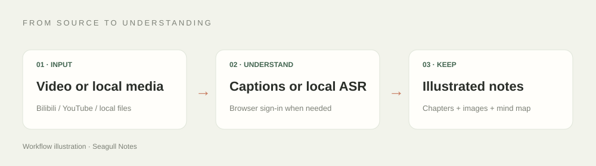
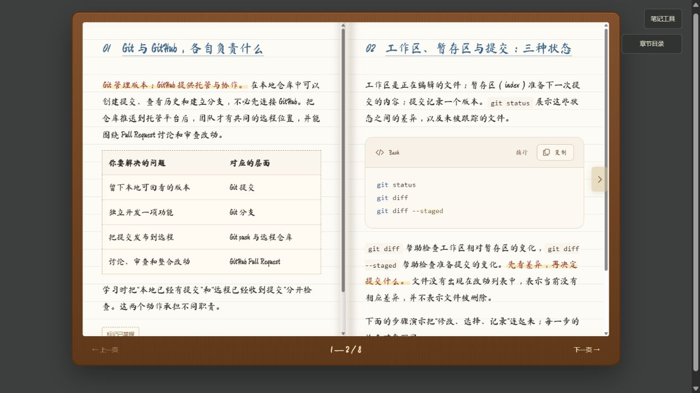

# Seagull Notes

English | [简体中文](README_CN.md)

Turn knowledge topics, pasted notes, article URLs, Bilibili, YouTube, and local materials into **illustrated, interactive notebooks with a personal shelf**.

Seagull Notes combines a Codex skill with local Python helpers. The helpers extract source material and render the notebook; your AI client reads the material and writes the notes. This workflow does not require a separate note-generation API key.

- **Captions first.** Prefer available platform captions, including automatic captions, and retain their timestamps.
- **Automatic Bilibili collection.** BV links use the local collector and reuse complete caption caches. `--anonymous` explicitly skips credentials.
- **Browser sign-in when needed.** Let the user complete sign-in in Codex's in-app browser, then read what that session can access.
- **Illustrated delivery.** Summaries, takeaways, chapters, source images, explanatory diagrams, and a mind map in a self-contained HTML file.
- **Topics, text, and webpages.** Ask for a subject tutorial, paste someone else's notes, or provide an article URL. The AI reads or researches the material, preserves attribution, and separates source content from its own extensions.
- **Three reading experiences.** Keep the beige Paper view, use the handwritten Handwritten Notes, or turn chapter pages in the Leather Book. Ruled paper, binding, sticky notes and marker highlights recreate the study-notebook feel; code and formulas remain readable and copyable.



## Quick start

Requires Python 3.10 or later. A dedicated Python environment is recommended.

```bash
git clone https://github.com/J1ngYue/seagull-notes.git
cd seagull-notes
python -m pip install -e ".[notes,browser]"
```

On Windows, use the absolute path to your actual Python installation instead of a Microsoft Store alias. For example:

```powershell
& 'D:\software\Anaconda\python.exe' -m pip install -e '.[notes,browser]'
```

Copy `skill/` into your client's skills directory as `seagull-notes`, for example `~/.agents/skills/seagull-notes/`. Install the Python project first so a copied skill can import its helpers. You can also use the skill directly from the checkout.

Ask Codex:

> Use seagull-notes to turn this video into illustrated Chinese notes: VIDEO_URL

You can also ask “Make me notes about Git and GitHub,” paste study text, or send an article URL. Topic requests are researched rather than treated as source material. Article notes retain their source links; video notes keep their caption workflow.

## Topic and text notebooks

The AI prepares the material, writes the notebook JSON, then renders it. The preparation command does not generate a finished lesson:

```bash
python skill/scripts/prepare.py --kind topic --source "Git and GitHub"
python skill/scripts/prepare.py --kind text --file pasted-notes.txt
python skill/scripts/prepare.py --kind url --source "https://example.com/article"
python skill/scripts/notebook.py note.json --style atlas
```

| Style | Experience |
| --- | --- |
| Paper (`paper`) | The existing beige illustrated reader |
| Handwritten Notes (`atlas`) | Cream ruled paper, spiral binding, Chinese handwriting, tape, sticky notes, marker highlights, and write-in chapters |
| Leather Book (`folio`) | A walnut leather cover with stitching, layered cream pages, a shaded spine, edge-hover arrows, keyboard navigation, and paper turns with changing light |



All three styles include a reading-font selector: style default, sans serif, Song-style serif, Kai-style calligraphy, and bundled handwriting. The browser remembers your choice across notebooks. Changing fonts repaginates Leather Book at the current content position; code and math retain their dedicated typography.

Topic, text, and article notes default to Handwritten Notes; existing video and local-media notebooks retain Paper. The two replicas center compact handwritten pages on a charcoal desk, with tools and chapter navigation in popovers. Handwritten Notes scrolls continuously. Leather Book measures the available page space and continues long chapters, paragraphs, lists, tables and review answers across as many facing pages as needed. Long code blocks span pages; each copy button still copies the complete original block. Overview, illustrations, reviews and references remain in appendix pages. Resizing recalculates pagination and preserves the reading position. Below 700px it uses a single page; reduced-motion preferences skip the turn animation. Every style keeps complete content, code/formula copying, mind maps and print support. Printing includes all chapters and appendices. Mastery marks and style preferences are stored locally. The existing `atlas` and `folio` values select the two replacement styles.

The shelf filters notes by source type and searches titles, summaries, and tags. `explorers`, `review`, and `extensions` add interactive learning components; see [the material and style guide](skill/references/materials-and-styles.md). Obsidian remains an optional export; the web notebook is the primary experience for the new styles.

The handwritten and leather-journal styling is adapted from [note-skill](https://github.com/Unclecheng-li/note-skill), with its MIT notice preserved. Seagull Notes retains its own ingestion, complete note content, shelf and copying controls. The bundled Chinese handwriting font works offline; its SIL OFL notice is preserved. See [asset provenance](skill/assets/handwritten/SOURCE.md).

Try the included Git/GitHub topic notebook with its official reference links, original flow diagram, step explorer, review questions, and extensions:

```bash
python skill/scripts/notebook.py examples/knowledge.json --style atlas --out data/artifacts/git-atlas
python skill/scripts/notebook.py examples/knowledge.json --style folio --out data/artifacts/git-folio
```

The included skill instructions and notebook interface are currently in Chinese. This English README describes the same workflow.

Send a link; the skill handles collection, import, reading, illustrations, rendering, and review. Your only normal intervention is sign-in or platform verification when required. For accessible captioned videos, the workflow targets a complete illustrated notebook within 45 minutes after sign-in. This is a processing target, not a guarantee for blocked sources, missing captions, or unusually large material.

Long tutorials default to detailed study notes unless you request a summary. Major demonstrations include their starting state, prerequisites, steps, commands, results, and verification, with important comparisons and troubleshooting preserved. Summaries and mind maps provide navigation; the main chapters retain the teaching detail. Faster delivery comes from cached captions and reusable rendering, without cutting essential content. The source tab retains the actual full transcript.

Coverage applies to short videos too. The skill maps every important concept, reasoning step, teaching example, key value, caveat, and closing explanation to a note chapter in a local `coverage.md`, then checks the full source for omissions. Repetition and advertisements may be removed; mentions in a summary or transcript do not replace a chapter explanation. Unverified visual details and source gaps are disclosed.

## Platform captions by default

Bilibili BV links automatically use the caption collector. Other sources use available platform captions or browser exports. Valid sign-in sessions are reused; sign-in is shown only when authentication is actually required. The normal workflow does not present a caption-versus-ASR choice.

Check both ordinary and automatic captions. Offer local ASR only after the authenticated session and video page confirm that both are absent. Login problems, rate limits, empty API responses, and export failures do not establish missing captions. Existing caption tracks keep the workflow on caption retrieval, even when ASR was enabled. Platform captions also take priority over cached ASR. Anonymous mode remains available on explicit request. Video descriptions and AI summaries are not substitutes for a full transcript.

### Fetch captions

```bash
python skill/scripts/fetch.py "VIDEO_URL"
```

By default, this command does not download the video, run ASR, or download a model. It writes JSON to stdout and progress messages to stderr:

- `content`: extracted text.
- `segments`: available `start`, `end`, and `text` values; times are in seconds.
- `origin`: the actual source, such as `platform_subtitle`, `subtitle_file`, or `asr`.
- `has_more` and `next_offset`: pagination when `--offset` and `--max-chars` are used.

Read every page before writing the note.

<details>
<summary>Fallback after confirming no ordinary or AI captions: local ASR</summary>

Before offering this fallback, check the dependencies and complete model cache, explain any required download and extra processing time, and obtain explicit authorization. Users may also explicitly request ASR or supply local media. To explicitly skip stored credentials, use `--anonymous`.

```bash
python -m pip install -e ".[notes,asr]"
python -m seagull_notes.cli prepare-model
python skill/scripts/fetch.py "VIDEO_URL" --anonymous --allow-asr
```

The default large-v3 model is approximately 3 GB. Model preparation is an explicit operation. Complete cached models load from their local snapshot; an empty cache directory is not treated as a usable model. Downloaded audio conversion requires FFmpeg and ffprobe.

ASR defaults to CUDA with float16. For CPU operation, set `SEAGULL_NOTES_ASR_DEVICE=cpu` and `SEAGULL_NOTES_ASR_COMPUTE=int8`. `SEAGULL_NOTES_ASR_MODEL` selects the model size.

Local files use the same helper:

```bash
python skill/scripts/fetch.py "/absolute/path/lecture.wav" --allow-asr
python skill/scripts/fetch.py "/absolute/path/captions.srt"
```

Transcription is local speech recognition, not platform-generated captions. Its timestamps are preserved on both fresh runs and cache hits.

</details>

## Render an illustrated notebook

```bash
python skill/scripts/notebook.py examples/notebook.json --out data/artifacts/demo
```

Open `data/artifacts/demo.html`. The included example illustrates the interface, rather than claiming to summarize a real video. The warm paper layout includes a cover, takeaway cards, chapter navigation, images, a mind map, Markdown, source details, and PDF printing.

Search the chapter directory, follow the highlighted current chapter, or use previous/next navigation and return to the top. On mobile, the directory expands on demand. Code cards can wrap long lines and show an inline copied state; copying retains the original text.

Rendered notebooks are automatically collected in `data/artifacts/notebooks/`. Open its `index.html` to browse illustrated cards and search your notes; each notebook links back to this library. Re-rendering the same input updates its entry, while separate inputs with the same title remain distinct. An explicit `--out` keeps that output and also adds a library copy. Tabs use a sliding selection pill and a soft panel entrance; reduced-motion preferences are respected.

Notes use warm white pages, beige cards, and brown accents, including code blocks, formulas, highlights, and mind-map nodes. Mind maps use a central topic, balanced branches, curved connectors, and wrapped bilingual labels. Use the mouse wheel to zoom around the pointer, or drag, fit, and expand the canvas. The same layout powers standalone maps and editable Obsidian Canvas exports.

### Editable Obsidian export

Each render also creates an Obsidian ZIP with native Markdown, independent image attachments, the transcript, an editable native Canvas mind map, and a scoped light CSS snippet. The library provides individual and combined ZIP downloads. Copy the package contents into your vault and enable `seagull-notes` under Appearance → CSS snippets once, or import directly:

```bash
python skill/scripts/notebook.py note.json --obsidian-vault "/absolute/path/to/vault"
```

Edit the text normally. Delete or move an image's `![[...]]` line, replace its attachment, or change `|760` to another width. SVG files remain editable vectors; raster screenshots remain images. The Canvas mind map supports changing text, moving nodes, and reconnecting arrows without a community plugin. Colors, headings, callouts, code cards, and illustrations retain the reading style; navigation uses Obsidian's interface. Existing vault files are preserved on re-import, so user edits are not overwritten.

The AI client prepares the JSON input; the renderer does not generate a summary. See [the input format](skill/references/notebook-format.md). Use `source_url` for a video or article, `source_ref` for an existing local file's absolute path, or `source_kind` with `source_text/source_origin` for topics and pasted text. Local timestamps are position labels; video timestamps link back to the video. Topic, text, and article chapters do not invent timestamps.

The Markdown tab shows the complete source with copy-all and `.md` download controls. Switching views preserves the reading position. Map and source views omit the original notebook decorations; the map's binding follows its own canvas when expanded or collapsed.

Use verified video frames for screenshots and label explanatory diagrams clearly. Images are embedded in HTML for offline reading; Markdown retains local image paths, so keep those files when moving the Markdown output.

### Code blocks and copying

Fenced code blocks include a language label, syntax highlighting, a bordered light card, and a copy button. Specify the actual language, such as `bash`, `python`, `java`, `cpp`, or `html`. Highlighting is generated with Pygments and embedded in the HTML for offline reading. Copying preserves the original code, indentation, line breaks, and special characters. Unknown languages remain copyable as plain text. Examples state their prerequisites and placeholder values; alternative operations use separate blocks.

### LaTeX formulas and one-click copying

Use `$...$` for inline math and `$$...$$` for display math in section Markdown. For example, `$$\theta_{t+1}=\theta_t-\eta\nabla L(\theta_t)$$`. Escape backslashes when writing JSON. Code blocks remain code.

Formulas are typeset with bundled KaTeX. Click a formula, or focus it and press Enter/Space, to copy the original LaTeX without the delimiters. The generated HTML includes the renderer and font files, so math works offline. The vendored KaTeX 0.19.0 assets are MIT-licensed; its license is preserved in `skill/assets/katex/LICENSE`.

### Generate numeric figures

```bash
python -m pip install -e ".[plots]"
python skill/scripts/plot.py examples/gradient-plot.json --out data/artifacts/gradient
```

The helper plots supplied numeric data and ordered update points, with real scales, numbered steps, and separate value labels. It exports SVG and PNG, checks for detected text clipping and overlap, and does not infer data from captions. Mark generated illustrations with `kind: "diagram"` to preserve their aspect ratio. Readers can click notebook images to inspect the full figure. See [figure guidance](skill/references/note-figures.md).

## Browser access, storage, and MCP

### Automatic local Bilibili caption collection

```bash
python -m pip install -e ".[notes,browser]"
python skill/scripts/fetch.py "https://www.bilibili.com/video/BV1LwHv6LEYz/" --local-browser
```

The collector reuses a dedicated Chrome profile in the background and verifies sign-in first. A valid session skips the login page. When authentication is needed, it prints a local `LOGIN_URL`; Codex opens this page visibly in its in-app browser. Scan the Bilibili QR code with the Bilibili app and confirm on your phone once; collection resumes automatically. This avoids relying on a separate Chrome window becoming visible. The collector profile is separate from both the in-app browser and your normal Chrome profile. Installed Chrome is preferred; otherwise install Chromium with `python -m playwright install chromium`.

`--local-browser` is optional for BV links: the default command selects it automatically unless an explicit credential or anonymous option is supplied. Valid full-caption caches are reused before launching Chrome or requesting sign-in. `cache_hit` and `collected_at` retain provenance; `--refresh` requests an updated platform copy. `collection_seconds` measures only the collection stage, not AI note generation.

Full caption JSON and SRT files are saved automatically under `data/captions/`. The existing `content`, `segments`, and `origin` output feeds the note workflow directly, with no manual export or import. The collector preserves the selected `p` and reports the first and last caption times for coverage review. It fetches platform captions, without audio/video downloads or ASR models, and does not export cookie files. Platform restrictions still apply. Currently it accepts full Bilibili BV links; YouTube and other sources retain their existing workflow.

The in-app browser and the Python downloader are separate sessions. Signing in through the browser does not automatically pass cookies to Python. YouTube transcript export and other platform caption access depend on the capabilities exposed by the current browser. See [the browser workflow](skill/references/browser-subtitles.md).

Models, media, cookies, databases, and generated notes remain outside Git. `SEAGULL_NOTES_HOME` overrides the project data location. Source text enters your AI client's context when it writes the notes; whether that context goes to a cloud service depends on the client.

The repository also contains legacy webpage, PDF, CLI, and MCP helpers. MCP is optional:

```bash
python -m pip install -e ".[mcp]"
python -m seagull_notes.server
```

Use a dedicated environment for MCP's server dependencies. The skill, renderer, caption fetcher, and local ASR do not require MCP. The legacy CLI's direct generation mode uses a rule-based fallback when no server-side model is configured; that is different from notes written by the AI client.

## Validation

```bash
python -m pip install -e ".[notes,plots,test]"
python -m pytest tests -q
```

Tests cover captions, cache behavior, anonymous mode, timestamps, local source references, model completeness, notebook rendering, and the original pipeline. They do not require network access, a GPU, or a generation API. Platform restrictions need real-video checks.

The notebook presentation was inspired by [CuteNote](https://cutenote.cc/). This project is not affiliated with CuteNote.

Figure-generation guidance was informed by the Matplotlib and scientific-visualization skills in Scientific Agent Skills: Kassis, T., Agarwal, V., He, Y., Patel, D., & Brueckner, A. M. (2026). [Scientific Agent Skills: A Library of Procedural Knowledge for Research Agents](https://doi.org/10.48550/arXiv.2609.00065).
