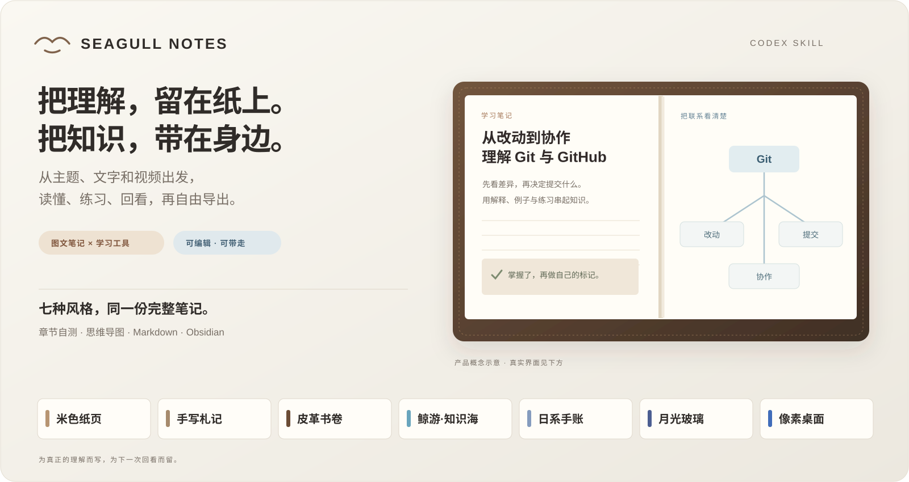
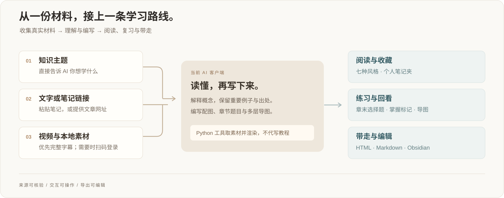
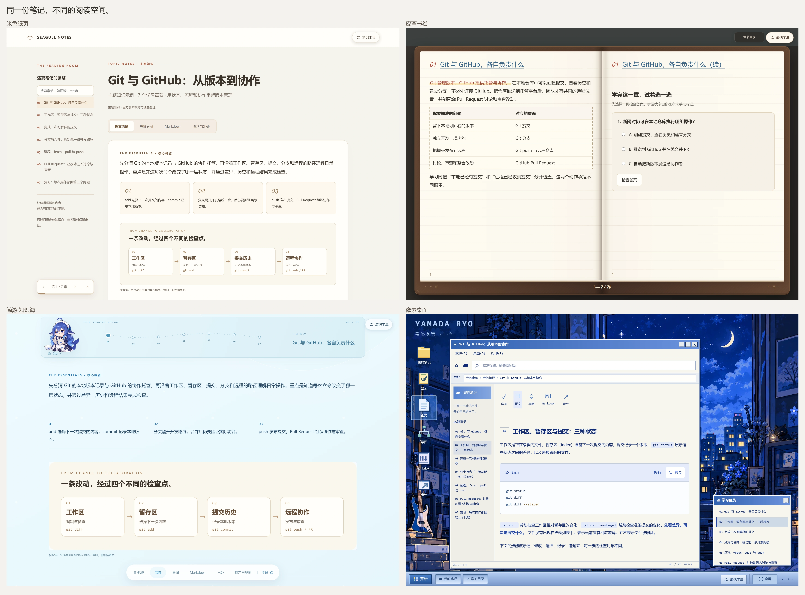

# Seagull Notes

[English](README.md) · 简体中文

**把看过、读过和想学的内容，变成值得翻回来的笔记。**

一套面向 Codex 的中文图文笔记技能。提出主题、粘贴笔记或文章链接，也可以发送 B站 / YouTube 视频，得到自己的笔记夹、七套阅读风格、章节自测、交互思维导图与可编辑导出。



[快速开始](#快速开始) · [阅读风格](#七种阅读空间) · [学习工具](#让阅读接上复习) · [导出笔记](#笔记可以带走继续编辑) · [技能说明](skill/SKILL.md)

## 从材料到笔记

| 你提供什么 | 技能会做什么 |
| --- | --- |
| **知识主题**：“帮我学 Git 与 GitHub” | AI 查阅可靠资料，整理有解释、有示例、有配图的教程。 |
| **已有笔记**：粘贴文字，或发送文章 / 笔记链接 | 读完材料，重新组织内容，保留资料出处。 |
| **视频材料**：B站、YouTube 或本地文件 | 优先读取可访问的完整字幕并保留时间轴；来源画面与解释示意图区分标注。 |



视频流程**确需认证时才扫码或登录**，已有有效会话与完整字幕缓存直接复用。普通字幕和 AI / 自动字幕优先；本地语音识别作为明确授权后的备选。

AI 客户端负责阅读、理解和编写，Python 工具负责取素材与渲染。**这条技能流程无需另配笔记生成 API key**，使用的是你已经配置的 AI 客户端。

## 七种阅读空间

可以切换阅读风格，完整正文、资料出处、代码、公式和学习进度都继续保留。

| 风格 | 阅读体验 |
| --- | --- |
| **米色纸页** · `paper` | 连续精读、章节导航与温暖纸色，适合专注阅读。 |
| **手写札记** · `atlas` | 横线纸、螺旋装订、内置手写体、胶带与荧光笔重点。 |
| **皮革书卷** · `folio` | 皮革缝线、实测双页排版与翻页动画，小屏幕自动使用单页。 |
| **鲸游·知识海** · `whale` | 开阔蓝色阅读空间、横向章节航线与四种肥鱼姿态。 |
| **日系手账** · `journal` | 山田凉蓝色拼贴、撕边纸、和纸胶带、五枚同时出现的透明贴纸与可编辑便签。 |
| **月光玻璃** · `moonlight` | 月夜房间、玻璃面板、笔记夹、侧栏与章节大纲。 |
| **像素桌面** · `pixel` | 真正按照 **我的笔记 → 笔记文件 → 学习 / 正文 / 导图 / Markdown / 出处** 打开内容的复古桌面。 |



*实际渲染界面，以 2 倍分辨率截图；点击图片可查看细节。英文 README 使用独立的英文演示配图，本页使用中文。*

主题、文字与网页笔记默认采用手写札记，视频与本地材料默认采用米色纸页。可在“笔记工具”中切换，也可以渲染时指定 `--style`。

## 让阅读接上复习

| 工具 | 已实现的交互 |
| --- | --- |
| **章节学习闭环** | 阅读正文 → 完成每章 2–3 道编写好的选择题 → 查看解析、重试 → 在章末手动标记“已掌握”。手账学习清单随之自动打勾划线，撤销掌握也会恢复；答题结果不会替你修改掌握状态。 |
| **交互思维导图** | 展开概念、步骤与易错点的多层分支；可以聚焦分支、围绕指针缩放、拖动画布、适应画布或展开查看。导图来自笔记内容，不只列章节标题。 |
| **手账快速便签** | 新增、编辑、完成、删除便签，支持撤销最近一次删除，并在本地浏览器自动保存。 |
| **桌面窗口** | 拖动、最小化、恢复、最大化与全屏；四角拖动等比例缩放，四边拖动分别调整对应方向。“开始”菜单与任务栏均可操作。 |
| **技术内容阅读** | 复制原始代码、切换长行换行、点击公式复制 LaTeX；五种阅读字体保留独立的代码与公式排版。 |
| **自己的笔记夹** | 浏览已保存笔记、按来源类型筛选，搜索标题、摘要和标签；同一输入重新渲染会更新原条目。 |
| **连贯的页面切换** | 阅读视图、风格、笔记夹与窗口状态采用柔和过渡，保留阅读位置，并尊重系统的减少动态效果设置。 |

皮革书卷会让长章节自动续页，不为适配页数删去正文。修改字体或调整窗口后重新分页，并保留内容位置。网页内嵌资源支持离线阅读；访问外部资料链接仍需网络。

## 快速开始

需要 **Python 3.10+**，以及能够加载技能的 AI 客户端。

```bash
git clone https://github.com/J1ngYue/seagull-notes.git
cd seagull-notes
python -m pip install -e ".[notes,browser]"
```

将 `skill/` 复制到客户端的技能目录，目录名为 `seagull-notes`，例如 `~/.agents/skills/seagull-notes/`。请保留已安装的 Python 项目：单独复制技能不会安装它依赖的 Python 工具。也可以直接使用仓库中的技能。

Windows 请使用真实 Python 安装路径，避免 Microsoft Store 别名，例如 `D:\software\Anaconda\python.exe`。

然后直接告诉 AI：

> 用 seagull-notes 给我做 Git 与 GitHub 的详细中文笔记，讲清仓库、分支、PR、合并与 fork，配操作例子和章节选择题。

> 把这个视频整理成图文笔记：视频链接

> 把下面这段笔记做成日系手账，保留原始出处，你补充的内容单独说明。

### 先试试仓库自带的笔记

无需抓取视频或配置生成 API，即可渲染 Git / GitHub 示例：

```bash
python skill/scripts/notebook.py examples/knowledge.json --style atlas --out data/artifacts/git-atlas
python skill/scripts/notebook.py examples/knowledge.json --style folio --out data/artifacts/git-folio
```

打开 `data/artifacts/git-atlas.html` 或 `data/artifacts/git-folio.html`。示例包含 **7 个章节、14 道章末选择题和 71 个导图节点**，保留官方参考资料链接。生成的笔记也会自动收录到 `data/artifacts/notebooks/index.html` 笔记夹。

渲染器展示已经编写好的 JSON 笔记，本身不负责编写教程。输入结构见 [笔记格式](skill/references/notebook-format.md)，写作与风格约定见 [通用材料与风格](skill/references/materials-and-styles.md)。

## 笔记可以带走，继续编辑

| 产物 | 用途 |
| --- | --- |
| **自包含 HTML** | 在浏览器阅读完整笔记，字体、配图、公式和交互随文件内嵌。 |
| **Markdown** | 复制全文或下载 `.md`。单独 Markdown 保留原图片路径，移动文件时需要同时保留图片。 |
| **Obsidian 包** | 原生 Markdown、独立图片附件、来源材料、可编辑 Canvas 导图与局部 CSS 片段；笔记夹支持单篇和合集 ZIP。 |
| **打印 / PDF** | 通过浏览器打印，打印或保存完整笔记为 PDF。 |

也可以选择直接导入已有 Obsidian 仓库：

```bash
python skill/scripts/notebook.py note.json --obsidian-vault "/absolute/path/to/vault"
```

导出内容可以继续编辑，重复导入时保留仓库已有文件。阅读导航沿用 Obsidian 自己的界面，不会把网页的七套 UI 直接搬进 Obsidian。

## 需要时再展开的进阶选项

<details>
<summary><strong>准备主题、文字、网页与字幕材料</strong></summary>

```bash
python skill/scripts/prepare.py --kind topic --source "Git 与 GitHub"
python skill/scripts/prepare.py --kind text --file pasted-notes.txt
python skill/scripts/prepare.py --kind url --source "https://example.com/article"
python skill/scripts/fetch.py "视频链接"
python skill/scripts/fetch.py "/absolute/path/captions.srt"
python skill/scripts/notebook.py note.json --style journal
```

素材准备命令保存原文供 AI 阅读；主题只是研究任务，不能冒充完整教程。技能核对材料覆盖、保留可核验出处与时间轴，并标明自己的解释补充。详见 [材料与写作约定](skill/references/materials-and-styles.md)、[配图规范](skill/references/note-figures.md)。

完整 B站 BV 链接默认走本地采集器，复用完整字幕缓存和专用 Chrome 配置。确需登录时返回本地 `LOGIN_URL` 交接扫码，之后自动继续。`--anonymous` 跳过凭证，`--refresh` 请求新的字幕副本。采集器、内置浏览器和日常浏览器属于不同会话，平台限制仍然适用。见 [字幕采集流程](skill/references/browser-subtitles.md)。

</details>

<details>
<summary><strong>可选的本地语音识别</strong></summary>

只有明确取得授权，且已核实普通字幕和 AI 字幕都不存在，或用户主动要求本地材料转写时，才使用 ASR。接口失败、登录失败不能证明没有字幕。

```bash
python -m pip install -e ".[notes,asr]"
python -m seagull_notes.cli prepare-model
python skill/scripts/fetch.py "/absolute/path/lecture.wav" --allow-asr
# 已取得授权后，可尝试读取公开视频的可访问音频：
python skill/scripts/fetch.py "视频链接" --anonymous --allow-asr
```

准备模型前先检查完整缓存。默认 `large-v3` 约 **3 GB**，模型下载和转写都需要用户授权。本地 ASR 明确标为语音识别，保留识别时间轴，不冒充平台字幕；术语和数字可能识别错误。

默认使用 CUDA / float16。CPU 模式设置 `SEAGULL_NOTES_ASR_DEVICE=cpu`、`SEAGULL_NOTES_ASR_COMPUTE=int8`；通过 `SEAGULL_NOTES_ASR_MODEL` 选择模型。

</details>

<details>
<summary><strong>存储、隐私与可选 MCP</strong></summary>

运行数据、模型、浏览器配置、Cookie 和生成笔记不会提交到 Git。`SEAGULL_NOTES_HOME` 可更改项目数据根目录。AI 编写笔记时会读取原文，是否发送云端取决于客户端配置。掌握状态、便签和外观偏好存于当前浏览器，不提供跨设备同步。

常规技能流程不依赖 MCP；需要时可以单独启用：

```bash
python -m pip install -e ".[mcp]"
python -m seagull_notes.server
```

建议为服务依赖使用独立环境。仓库也保留早期 CLI 和采集工具；CLI 的规则回退结果与 AI 实际编写的笔记不同。

</details>

## 开发与致谢

```bash
python -m pip install -e ".[notes,plots,test]"
python -m pytest tests -q
```

测试覆盖采集、缓存、时间轴、渲染、导出与来源处理；真实平台访问仍取决于平台情况和浏览器会话。

- 手写与皮革样式改编自 [note-skill](https://github.com/Unclecheng-li/note-skill)，保留 MIT 许可与内置字体的 SIL OFL 许可，见 [手写资源出处](skill/assets/handwritten/SOURCE.md)。
- 公式排版使用内置 [KaTeX](https://katex.org/)，保留 [MIT 许可](skill/assets/katex/LICENSE)。
- 主题配图与角色素材各有独立出处和权利归属，见 [主题资源说明](skill/assets/themes/SOURCE.md)。本项目与 DeepSeek、《孤独摇滚！》无官方关联。
- 早期笔记展示受 [CuteNote](https://cutenote.cc/) 启发，双方无关联；配图规范也参考了 [Scientific Agent Skills](https://doi.org/10.48550/arXiv.2609.00065)。

文档截图为生成界面演示，不代表处理过某个特定视频。实际笔记中的来源截图与解释示意图会分别标注。
