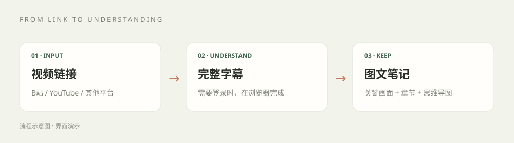

# Seagull Notes

[English](README.md) | 简体中文

把 B站、YouTube 和本地音视频整理成**图文笔记、思维导图、Markdown 和可离线阅读的 HTML**。

这是一套 Codex skill 与本地 Python 工具：脚本负责取素材和渲染，AI 客户端负责读完素材、理解内容并写笔记。默认流程无需另配笔记生成 API key。

- **字幕优先**：读取可访问的平台字幕，包括自动字幕，保留可取得的时间轴。
- **B站自动采集**：BV 链接默认走本地采集器，复用完整字幕缓存；`--anonymous` 明确跳过凭证。
- **需要时交接登录**：由用户在 Codex 内置浏览器完成登录，再读取该会话可访问的内容。
- **图文交付**：摘要、核心收获、章节、来源画面、解释示意图和脑图，生成自包含 HTML。



## 快速开始

需要 Python 3.10+，建议使用独立 Python 环境。

```bash
git clone https://github.com/J1ngYue/seagull-notes.git
cd seagull-notes
python -m pip install -e ".[notes,browser]"
```

Windows 使用实际 Python 的绝对路径，避免 Microsoft Store 别名。本机示例：

```powershell
& 'D:\software\Anaconda\python.exe' -m pip install -e '.[notes,browser]'
```

将仓库内 `skill/` 复制到客户端的 skills 目录，目录名为 `seagull-notes`，例如 `~/.agents/skills/seagull-notes/`。先安装 Python 项目，复制后的 skill 才能导入项目包；也可以直接使用仓库中的 skill。

在 Codex 中发送：

> 用 seagull-notes 把这个视频整理成图文笔记：视频链接

目前 skill 指令与笔记界面为中文，英文 README 介绍的是同一套流程。

用户发链接；skill 完成采集、导入、全文阅读、配图、排版和检查。正常情况下用户只需要在真实需要认证时登录/完成平台验证。对可读取字幕的视频，以登录完成后 45 分钟内交付完整图文笔记为目标；这不是对无字幕、访问受限或异常长素材的固定耗时保证。

长课程默认生成详细学习笔记，用户明确要求摘要时才压缩。主要演示保留起始状态、操作前提、步骤与命令、结果和验证方法，关键对比与问题处理也要讲清楚。摘要和脑图用于导航，正文保留教学细节；通过缓存字幕和复用渲染提高速度，不省略重要内容。原文标签保留实际取得的完整字幕。

短视频也要求覆盖全部重要内容。skill 会在本地 `coverage.md` 中把每个重要概念、推导步骤、教学例子、关键数字、限制和结尾补充对应到正文章节，再对照完整素材查漏。可以删除口语重复与广告；摘要或原文中的提及不能替代正文解释，未取得的画面信息和素材缺段会明确说明。

## 默认登录读取平台字幕

B站 BV 链接默认自动使用平台字幕采集器，其他来源使用可用的平台字幕或浏览器导出。已有有效登录态时直接复用，确需认证才显示登录页；常规流程隐藏 ASR，不弹并列路径选择。

同时检查普通字幕和 AI 字幕，只有已登录会话与视频页面确认两类字幕都不存在时，才提供本地 ASR。登录问题、风控、接口暂空、字幕导出失败都不能当作无字幕；字幕轨存在时继续获取字幕，已启用 ASR 也不因导出失败切换。平台字幕优先于旧 ASR 缓存。用户明确要求匿名时仍可指定；视频简介和平台 AI 总结不能冒充完整字幕。

### 获取平台字幕

```bash
python skill/scripts/fetch.py "视频链接"
```

默认不下载视频、不跑 ASR、不下载模型。stdout 返回 JSON，日志写 stderr：

- `content`：完整提取文本。
- `segments`：可取得的 `start/end/text`，时间单位为秒。
- `origin`：真实来源，如 `platform_subtitle/subtitle_file/asr`。
- `has_more/next_offset`：使用 `--offset/--max-chars` 分页时的后续位置。

读完全部分页，再整理笔记。

<details>
<summary>确认普通字幕和 AI 字幕均缺失后的备选：本地 ASR</summary>

提出备选前检查依赖和完整模型缓存，说明需要的下载及额外耗时，再取得明确授权。用户主动要求 ASR 或提供本地音视频时也可显式使用。需要跳过保存凭证时指定 `--anonymous`。

```bash
python -m pip install -e ".[notes,asr]"
python -m seagull_notes.cli prepare-model
python skill/scripts/fetch.py "视频链接" --anonymous --allow-asr
```

默认 large-v3 模型约 3 GB，准备模型是显式操作。完整缓存可直接从本地快照加载，空缓存目录不会被当成可用模型。下载音频的转码需要 FFmpeg/ffprobe。

ASR 默认 CUDA/float16。CPU 模式设置 `SEAGULL_NOTES_ASR_DEVICE=cpu` 与 `SEAGULL_NOTES_ASR_COMPUTE=int8`；`SEAGULL_NOTES_ASR_MODEL` 可选择模型大小。

本地素材也使用同一脚本：

```bash
python skill/scripts/fetch.py "/素材的绝对路径/lecture.wav" --allow-asr
python skill/scripts/fetch.py "/素材的绝对路径/captions.srt"
```

本地 ASR 是语音识别，不是平台 AI 字幕。首次转写和缓存命中都会保留时间轴。

</details>

## 生成图文笔记

```bash
python skill/scripts/notebook.py examples/notebook.json --out data/artifacts/demo
```

打开 `data/artifacts/demo.html`。仓库示例是界面演示，没有冒充真实视频笔记。页面包含暖白纸张布局、封面、重点卡片、章节目录、配图、脑图、Markdown、出处与打印 PDF。

目录可搜索并自动定位当前章节，底部可切换上一章/下一章或返回顶部；手机目录按需展开。代码框可切换长行自动换行，复制后在按钮上显示成功反馈，复制内容仍保留原文。

生成的图文笔记会自动收录到 `data/artifacts/notebooks/`。打开其中的 `index.html`，即可通过图文卡片浏览和搜索；每篇顶部可返回笔记夹。同一输入重新生成会更新原条目，不同输入同名也不会覆盖；指定 `--out` 时保留原输出并额外收录。格式切换采用滑动选中胶囊与柔和淡入，尊重系统减少动态效果的偏好。

### 可编辑的 Obsidian 导出

每次渲染也生成 Obsidian ZIP，包含原生 Markdown、独立图片附件、完整原文、可编辑的原生 Canvas 脑图和专用淡色 CSS。笔记夹可下载单篇或全部导出包。把内容放进 vault，首次在设置 → 外观 → CSS 代码片段启用 `seagull-notes`；也可直接导入：

```bash
python skill/scripts/notebook.py note.json --obsidian-vault "/实际vault的绝对路径"
```

正文可直接编辑；删除或移动图片的 `![[...]]` 行即可删图、换位置，替换附件即可换图，修改 `|760` 可调显示宽度。SVG 保留矢量源文件，截图仍是原图片；Canvas 脑图可拖节点、改字和连接箭头，不需额外插件。保留淡色配色、标题、重点框、代码和图文结构，导航采用 Obsidian 自带界面。重导入保留已有文件，避免覆盖用户修改。

输入 JSON 由 AI 客户端整理，渲染器本身不生成摘要。格式见 [notebook-format.md](skill/references/notebook-format.md)。网络来源填写 `source_url`，本地来源填写实际文件绝对路径 `source_ref`。本地时间显示为素材位置标记，网络时间可跳转原视频。

截图使用经过核实的原视频画面，自绘图明确标注示意图。图片嵌入 HTML，离线仍可读；Markdown 保留图片原本地路径，移动 Markdown 时需一并保留图片。

### 代码框与复制

代码围栏注明实际语言，如 `bash`、`python`、`java`、`cpp` 或 `html`。页面显示语言标签、语法高亮、独立淡色圆角框和复制按钮。Pygments 生成的高亮与样式嵌入 HTML，离线可用；复制保留原代码、缩进、换行和特殊字符，未知语言按纯文本展示并可复制。示例注明前提与替换值，互斥操作分成不同代码框。

### LaTeX 公式与单击复制

正文中 `$...$` 为行内公式，`$$...$$` 为独立公式，例如 `$$\theta_{t+1}=\theta_t-\eta\nabla L(\theta_t)$$`。写入 JSON 时转义反斜杠，代码块继续按代码显示。

公式使用内置 KaTeX 排版；单击公式，或聚焦后按 Enter/空格，可复制不带定界符的 LaTeX 源码。渲染器和字体嵌入生成的 HTML，离线也能显示。内置 KaTeX 0.19.0 使用 MIT 许可，原许可保存在 `skill/assets/katex/LICENSE`。

### 生成数值配图

```bash
python -m pip install -e ".[plots]"
python skill/scripts/plot.py examples/gradient-plot.json --out data/artifacts/gradient
```

绘图器按传入数值和更新点生成真实尺度、步号与数值对照，导出 SVG/PNG，并检查已检测到的文字裁切与重叠；不会从字幕编造数据。示意图标记为 `kind: "diagram"`，按原比例显示；读者可点击配图查看大图。详见 [配图规范](skill/references/note-figures.md)。

## 浏览器、数据与 MCP

### 自动采集本地 B站字幕

```bash
python -m pip install -e ".[notes,browser]"
python skill/scripts/fetch.py "https://www.bilibili.com/video/BV1LwHv6LEYz/" --local-browser
```

采集器在后台使用专用 Chrome 配置，先验证登录状态；已有有效登录时不弹提示。需要认证时返回本地 `LOGIN_URL`，Codex 会在内置浏览器中可见地展示登录页。用 B站 App 扫码并在手机确认一次，成功后自动继续，不依赖单独的 Chrome 窗口能否弹到前台。专用配置与内置浏览器、普通 Chrome 个人配置分开。优先使用已安装的 Chrome；没有时可用 `python -m playwright install chromium` 安装浏览器。

BV 链接可以省略 `--local-browser`，未明确指定匿名或其他凭证来源时自动选用采集器。完整字幕缓存可用时，在启动 Chrome 或提示登录前直接复用；`cache_hit/collected_at` 保留来源与采集时间，`--refresh` 更新平台字幕。`collection_seconds` 仅计采集阶段，不是 AI 整理笔记的总耗时。

全文 JSON/SRT 自动保存到 `data/captions/`；返回现有的 `content/segments/origin` 格式，可直接交给笔记流程，无需手动导出或导入。分 P 对应当前视频片段，结果包含首末字幕时间供完整性核对。采集器只获取平台字幕，不下载音视频或 ASR 模型，也不导出 Cookie 文件；平台访问限制仍然适用。目前接受完整 B站 BV 链接，YouTube 等来源继续使用原有流程。

内置浏览器与 Python 下载器是不同会话，浏览器登录后 Cookie 不会自动传给 Python。YouTube 字幕导出和其他平台字幕读取，取决于当前浏览器提供的能力。详见 [浏览器流程](skill/references/browser-subtitles.md)。

模型、媒体、Cookie、数据库和笔记产物不进入 Git。`SEAGULL_NOTES_HOME` 可更改项目数据目录。AI 客户端整理时，素材进入其上下文；是否发送到云端取决于客户端配置。

仓库也保留旧的网页、PDF、CLI 与 MCP 工具。MCP 现在是可选依赖：

```bash
python -m pip install -e ".[mcp]"
python -m seagull_notes.server
```

建议在独立环境安装 MCP 的 Web 服务依赖。普通 skill、渲染器、字幕获取和本地 ASR 都不需要 MCP。旧 CLI 的直接生成模式在没有服务端模型时使用规则降级输出，不等同于 AI 客户端写的笔记。

## 验证

```bash
python -m pip install -e ".[notes,plots,test]"
python -m pytest tests -q
```

测试覆盖字幕、缓存、匿名模式、时间轴、本地来源、模型完整性、图文输出和原有管线，不依赖网络、GPU 或生成 API。平台访问限制仍需真实视频链接验证。

页面呈现参考 [CuteNote](https://cutenote.cc/)，项目与 CuteNote 无隶属关系。

绘图流程参考了 Scientific Agent Skills 的 Matplotlib 与 scientific-visualization 指引：Kassis, T., Agarwal, V., He, Y., Patel, D., & Brueckner, A. M. (2026). [Scientific Agent Skills: A Library of Procedural Knowledge for Research Agents](https://doi.org/10.48550/arXiv.2609.00065)。
